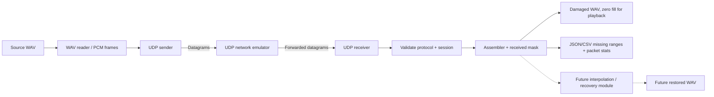

# AGENTS.md — EchoRestore engineering instructions

## Project mission

EchoRestore is an educational, portfolio-quality C++20 project for investigating the transmission of uncompressed audio over an unreliable UDP network and the reconstruction of missing audio segments. The networking implementation must work independently of the future numerical interpolation module. This repository is a **monorepo** and belongs to a shared GitHub organization.

The core experiment is:

`WAV -> PCM frames -> UDP sender -> UDP network emulator -> UDP receiver -> missing-frame map -> damaged WAV + machine-readable loss report -> (future numerical reconstruction)`

**Current milestone: deliver a complete, demonstrable network pipeline and damaged audio output. Do NOT implement numerical interpolation yet.** Do not implement a graphical interface, microphones, live audio playback, RTP compatibility, FEC, ARQ, or distributed computing in this milestone. Design interfaces so these can be introduced later.

The objective is to understand real socket programming and packet handling, not merely to drop samples directly from a WAV file. The emulator must operate on actual UDP datagrams.

## Working agreement for Codex

1. Read this file and the repository's current code before modifying anything. Inspect the existing CMake targets, style, dependencies, and tests first; integrate with them rather than duplicating code.
2. Work in **small, testable milestones**; do not implement the entire roadmap in one undifferentiated change. In each requested milestone, briefly state the files to change, implement the milestone, run/build tests, and report precisely what was verified and what remains.
3. Do not silently change the packet protocol, end-of-session policy, supported audio format, or scope. Explain the trade-off and document any necessary change.
4. Favor understandable, idiomatic C++20 over abstractions that are difficult to justify. Keep transport, protocol, emulator, WAV I/O, reconstruction boundary, and CLI separate.
5. No fabricated test results. If a toolchain is unavailable, say so and provide reproduction commands.
6. Do not hardcode developer-specific filesystem paths, IP addresses, or project organization names. Make these configurable.
7. When adding a dependency, justify it. Prefer the standard library, POSIX sockets on Linux, and CMake; GoogleTest can be added for tests, but a dependency-free CTest executable is also fine.
8. Add documentation and tests alongside a feature. Use deterministic seeds for reproducible experiments.
9. Confirm each implemented milestone before moving to major new features; the user controls prioritization.
10. Never rewrite or overwrite contributions to numerical-methods modules without an explicit request. They will be written by multiple collaborators.

## Primary platform and build

- Language: **C++20**.
- Primary development/runtime: **Linux (native Linux, WSL2, or Linux VM)**; suitable for a Windows laptop with WSL2. Do not assert that the POSIX code builds natively on Windows.
- Build system: **CMake + CTest**.
- Preferred compiler: GCC or Clang, use `-Wall -Wextra -Wpedantic`.
- Initial networking API: POSIX `socket`, `bind`, `sendto`, `recvfrom` or `recvmsg`, `poll`/`select` as appropriate. Avoid heavyweight frameworks for the first version.
- Audio: uncompressed RIFF/WAVE, **16 kHz, mono, signed 16-bit PCM**. Fail clearly for unsupported formats. Read WAV chunks correctly; do not assume `fmt ` and `data` are at fixed offsets. Write correct WAV headers and data sizes.
- Packet size: nominally **20 ms** = 320 samples = 640 audio bytes. The final frame may have fewer samples.
- Sender must be able to transmit to a configured destination IP and UDP port; receiver binds to configurable address/port.
- A Python analysis layer may be added later; it must not be necessary to run the C++ network MVP.

## Desired repository layout (adapt to an existing repository)

```text
.
├── AGENTS.md
├── README.md
├── CMakeLists.txt                 # shared build policy and component selection
├── common/
│   ├── CMakeLists.txt
│   ├── include/echorestore/audio/wav.hpp
│   ├── src/audio/wav.cpp
│   ├── apps/generate_sample.cpp
│   └── docs/WAV.md
├── network/
│   └── docs/                     # PROTOCOL.md, EXPERIMENTS.md
├── numerical/
│   └── docs/                     # guidance for math contributors
├── examples/                     # shared sample data and CLI walkthrough
├── docs/                         # ARCHITECTURE.md, MILESTONES.md
└── .github/workflows/ci.yml       # once build/verification is stable
```

Each implemented component owns its implementation, headers, apps and documentation.
Network and numerical components currently contain documentation only. Add their
source/header/app directories and CMake targets with working implementations;
do not create empty API or executable placeholders.
`common` has no network or numerical dependency. `network` and `numerical` do
not depend on each other; each may use shared libraries explicitly. Keep public
include paths and CMake aliases stable. Tests are currently deferred to the team
at the user's request; do not add test infrastructure or sanitizer options.


Library boundaries:
- `audio`: parse/serialize WAV and convert PCM16 to/from a clearly documented internal format; no socket dependency.
- `protocol`: encode/decode datagram headers and payloads; no socket or WAV-file dependency.
- `network`: send/receive UDP; assemble packets into a time-indexed buffer; no interpolation dependency.
- `emulator`: consume and forward datagrams according to a configured fault model; cannot rewrite audio content.
- `recovery`: future algorithm interface; no interpolation implementation in the current milestone.
- `apps`: small command-line composition roots; no core implementation logic.

## On-wire protocol: EchoRestore protocol v1 (custom, NOT RTP)

Use a documented, explicitly serialized **24-byte header**. Do not send raw C++ structs with padding/alignment; serialize each field by fixed byte offsets. All multibyte header fields use **network byte order (big-endian)**. PCM16 payload samples are **little-endian** (clearly documented).

| Byte offset | Size | Field | Meaning |
|---|---:|---|---|
| 0 | 4 | magic | ASCII `ECHO` |
| 4 | 1 | version | `1` |
| 5 | 1 | type | `1` = audio |
| 6 | 2 | reserved | zero; reject unsupported nonzero values |
| 8 | 4 | session_id | session ID provided via CLI/manifest |
| 12 | 4 | sequence | monotonically increasing from 0 for this MVP |
| 16 | 4 | sample_offset | first sample index (0-based) within the source |
| 20 | 2 | sample_count | count of PCM16 samples in payload |
| 22 | 2 | payload_bytes | exactly `2 * sample_count` |
| 24 | variable | payload | PCM16 mono audio samples |

Constraints for MVP: fixed 320 samples per frame except the last; validate boundaries, length and session ID; reject malformed/oversized/unsupported packets; payload length must exactly match the announced length and UDP datagram length. Use bounded buffers and check overflow. `sample_offset = sequence * frame_samples` is expected for this simple format, except only length differs on the last packet. The exact total sample count is known from the **session manifest** before reception. For now refuse inputs that would overflow 32-bit offsets; protocol evolution can widen fields later. Do not silently treat arbitrary UDP datagrams as valid.

The protocol does not provide CRC or cryptographic integrity and is not secure against hostile peers. Restrict the MVP to trusted local/test networks. A UDP checksum may be present at transport level but is not a replacement for application validation.

## Session manifest and termination policy

A crucial design choice: **a missing last packet cannot be discovered from observed sequence numbers alone**, and UDP does not guarantee an `END` control packet either.

For the initial offline experiment, adopt an **out-of-band known manifest**, supplied via CLI or a small versioned metadata file generated from the source WAV, containing:

- `session_id`, `sample_rate = 16000`, `channels = 1`, `format = PCM_S16LE`
- `total_samples` and `frame_samples = 320`
- `expected_packet_count = ceil(total_samples / frame_samples)`

Do not send the reference audio to the receiver; only metadata may be shared. Document that this is an experimental harness, not a self-contained internet audio session protocol.

Receiver receives while either:
- all expected unique packets have arrived, or
- its explicitly configured **overall receive deadline** expires.

The deadline should use a monotonic clock, not `system_clock`. `--timeout-ms` includes the period between starting the receiver and starting the sender, so document startup order and choose a sensible explicit default (e.g. 10 s). Do not claim that timeout proves packets are permanently lost: `missing` means **not received by cutoff**. Record late/duplicate/reordered packet statistics where observable; packets arriving after process exit obviously cannot be measured. A future milestone may add an out-of-band reliable control channel, per-frame deadlines and streaming jitter buffer.

For a 1-second file at 20 ms/frame, there are exactly 50 expected packets. If packets #0, #3, and #49 never arrive, the receiver still produces a 1-second output with the corresponding intervals marked missing.

## Responsibilities and flow



Recommended simple command-line apps (exact option names may evolve, but document consistently):

```bash
# Build
cmake -S . -B build -DCMAKE_BUILD_TYPE=Debug
cmake --build build -j
ctest --test-dir build --output-on-failure

# In three terminals on the same laptop, start receiver first:
./build/echorestore_receiver --bind 127.0.0.1 --port 9002 \
  --manifest examples/sample.json --timeout-ms 10000 \
  --output output/damaged.wav --report output/report.json

./build/echorestore_emulator --bind 127.0.0.1 --listen-port 9000 \
  --forward-host 127.0.0.1 --forward-port 9002 \
  --loss 0.05 --seed 42

./build/echorestore_sender --input examples/sample.wav \
  --host 127.0.0.1 --port 9000 --session-id 1 --frame-ms 20 --pace
```

Specify one canonical workflow for generating `examples/sample.json` (e.g. `echorestore_sender --input ... --write-manifest ...` or a separate helper). **Do not require manual transcription of total_samples**. If `--pace` is used, send a 20 ms frame every 20 ms using a monotonic deadline (`sleep_until` with planned timestamps), not `sleep_for(20ms)` after potentially blocking work. In an optional fast test mode, no pacing is needed.

For tests, ensure CLI startup orchestration is robust. Terminate a running emulator by signal / controlled shutdown, not by expecting it to exit when one file ends unless an explicit protocol for that exists.

## Assembler contract

- Allocate audio samples by `total_samples` and a distinct availability mask; **a sample value of zero is not evidence of loss**.
- Validate datagram session and range before writing. Handle duplicates without double counting. If duplicate data disagree, log a conflict and apply a defined first-wins policy (or reject and document); never silently corrupt the buffer.
- Store frames by `sample_offset` regardless of arrival order.
- Missing samples remain **unavailable** in memory; only when writing `damaged.wav`, convert unavailable samples to `0` for listenable output.
- Preserve original sample count, sample rate, channel count, and boundaries.
- Emit `report.json` containing metadata, expected/received/missing packet counts, missing ranges expressed in sample indices, duplicate count, observed out-of-order count, malformed count, and termination reason (`all_received` or `timeout`). Clearly distinguish observed loss from configured drop probability.
- Avoid the incorrect assumption that holes in increasing sequence numbers are immediately permanently lost; retain placeholders until the receive cutoff.
- Persist reports with JSON escaping / proper serialization and stable field names. Write outputs atomically where practical and create required output directories.

## Network emulator contract

- An actual intermediary UDP application; it listens on an input port and forwards byte-identical datagrams to the configured receiver.
- Initial fault model: independent Bernoulli packet dropping with `--loss` in `[0,1]` and user-selectable `--seed`.
- Forward all datagrams without modification when `--loss 0` (except for natural OS/environment effects). Count received, intentionally dropped, forwarded, and failed-to-forward; print/report these counts on controlled shutdown.
- Implement the first version synchronously for zero-delay drop-only forwarding. Future extensions: a monotonic time-scheduled priority queue for delay/jitter, random reordering, duplicate injection, burst-loss model (Gilbert–Elliott), and deterministic trace replay.
- Do not use a blocking `sleep` per packet when adding delays: that artificially serializes packet handling. No sleeps at all are needed for drop-only emulation.
- Include basic signal handling for graceful shutdown and log flush.

## MVP experiments and expected behavior

1. **No loss**: send a known deterministic 1-second 16 kHz PCM16 mono WAV: all 50 packets arrive, and the output WAV's PCM samples equal the input PCM samples bit-for-bit. The WAV container bytes may differ (metadata/chunk layout).
2. **100% configured loss**: no audio packet arrives. Receiver terminates at timeout, outputs the correct-length silent damaged WAV, and reports the entire signal as missing. Cannot infer loss from an empty stream without the manifest.
3. **Seeded 5% loss**: reproduce a deterministic drop pattern using a fixed seed and same send order; verify missing range lengths and report consistency. Do not promise exactly 5% observed loss in any finite run.
4. **Out-of-order**: inject a known frame order in tests and verify the reconstructed PCM indices are correct; out-of-order is not by itself loss.
5. **Duplicates**: inject duplicate datagrams; verify only one copy is used.
6. **Malformed**: reject shortened, oversized, corrupt-field, wrong-session, and out-of-bounds packets without crash or overwrite.
7. **Final packet missing**: output still has exactly `total_samples` samples and reports the last frame missing.
8. **Partial last frame**: e.g. 16,001 samples -> 51 packets with the final packet containing one sample.
9. **Start/stop safety**: all processes finish/stop cleanly, socket errors surface clearly, timeout works, files are written only in valid states.

A real socket integration test should use loopback with random/free UDP ports and process orchestration that is not flaky. Unit tests should test packet encode/decode, WAV input/output, assembler, and emulator decision logic deterministically.

## Future numerical module: reserved boundary, not implementation

The math team will supply numerical interpolation algorithms later. Define a minimal, flexible contract conceptually (adapt only after their summary):

```cpp
struct MissingRange { size_t start; size_t length; };
struct AudioBuffer { std::vector<float> samples; uint32_t sample_rate; };
class IRecoveryAlgorithm {
public:
    virtual ~IRecoveryAlgorithm() = default;
    virtual void recover(AudioBuffer& audio,
                         std::span<const MissingRange> ranges) = 0;
};
```

The actual API must be agreed with the math contributors; don't pre-implement spline, Lagrange, or other interpolation. Offline algorithms may use known samples on both sides of a gap. Streaming algorithms may not have future samples; document this distinction.

A network loss mask must remain available **separately from the zero-filled damaged WAV**, so future algorithms distinguish missing samples from genuine silence. Do not make networking dependent on algorithm choice.

## Later streaming milestone (OUT OF SCOPE now)

The real-time receiver will have a jitter/reordering buffer, packet playout deadlines, and a compute budget for packet-loss concealment (PLC). A recovery operation must begin before its playout deadline:

`recovery_start_deadline = playout_deadline - worst_case_budget - safety_margin`

The worst-case budget is unknown until benchmarking. Use measured distribution (especially p99) and a bounded fallback mechanism, not a guarantee based on mean runtime. If a method needs **future samples**, it must wait for them and therefore adds lookahead latency. Packet arrival after a deadline may be useful for statistics but not for already-played audio. Network `not received by deadline` differs from permanent packet loss.

Do not add timers, threads or complex adaptive jitter algorithms to the offline MVP unless required for correctness. The first milestone is complete when the damaged WAV plus missing-mask report are generated reliably from actual network traffic.

## Milestone order (create issues or a TODO checklist)

- **M0: Skeleton and tooling** — CMake targets, compiler warnings, CTest, README quickstart, `.gitignore`, sample generation helper. Verify build/test.
- **M1: WAV I/O + packet format** — robust RIFF PCM16 WAV read/write; encode/decode 24-byte datagram; unit tests incl. invalid inputs.
- **M2: Direct UDP sender/receiver (no emulator)** — pacing option, manifest generation, receiver assemble and cutoff, report, damaged WAV. Demonstrate loss-free roundtrip.
- **M3: UDP emulator** — seedable Bernoulli packet drop; separate process; statistics; demonstrate reproducible incomplete file and correct mask.
- **M4: Robustness and automation** — duplicates/out-of-order tests, partial last packet, invalid datagrams, integration tests, CLI usability, CI on Linux, Wireshark instructions.
- **M5: Future extension (only after approval)** — delay/jitter/reordering scheduler, burst loss; optionally Docker/netem; later recovery module after math API agreement.

On every milestone completion, communicate build commands, tests run, demonstrable result, and exact next task. Aim for code that a technical reviewer can understand quickly.

## Scientific and documentation standards

- Distinguish *configured emulator drop rate*, *observed missing by cutoff*, and later *late for playout*; do not label all as identical network losses.
- Report measured values without inventing network statistics. Compare algorithms with the **same loss trace** once the math part exists.
- Initial format is uncompressed PCM rather than Opus: this simplifies sample-level numerical analysis but does **not** make the project a realistic complete VoIP implementation.
- UDP is genuinely used for live media, often under RTP; EchoRestore's custom protocol is an educational design, not an RFC-compatible RTP implementation.
- The project aims at a reproducible engineering study, not a novel industrial-grade PLC codec.
- Keep README concise and accessible; deeper protocol decisions go into `network/docs/PROTOCOL.md`, experiments into `network/docs/EXPERIMENTS.md`.
