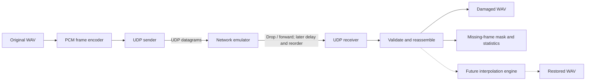
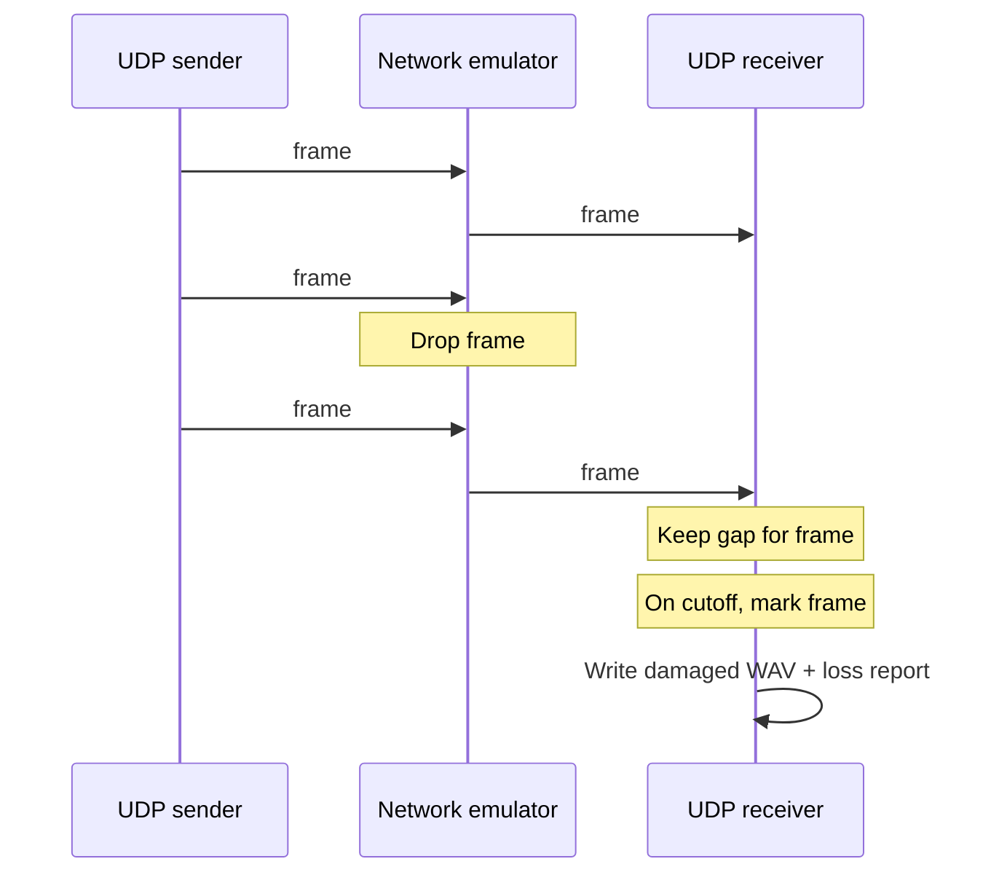

# EchoRestore

**Experimental audio transmission and packet-loss recovery over UDP.**

EchoRestore is a C++20 project that explores what happens when audio is transmitted across an unreliable network and some packets are lost, delayed, or delivered out of order. The initial implementation focuses on a real UDP-based transport pipeline and reproducible packet-loss experiments. A separate numerical module will later attempt to reconstruct the missing parts of the signal using interpolation methods.

> **Project status:** M0 scaffold and the WAV portion of M1 are implemented. Packet serialization, networking applications, UDP transmission and interpolation are not implemented yet.

## Build and try

Use Linux (native, WSL2 or a Linux VM), CMake 3.20+ and a C++20 compiler
(GCC or Clang). No third-party dependencies are required.

```bash
cmake -S . -B build -DCMAKE_BUILD_TYPE=Debug
cmake --build build -j
./build/echorestore_generate_sample examples/sample.wav
```

The helper produces a deterministic one-second 16 kHz mono PCM16 WAV; see
[examples](examples/README.md). Tests are deferred and will be added by the team.

## Source layout

- `common/{src,include,apps,docs}/`: implemented WAV I/O and sample generator.
- `network/docs/`: protocol specification and planned network experiments.
- `numerical/docs/`: guidance for the future numerical component.
- `examples/`: shared sample data and usage instructions.
- `docs/`: [architecture](docs/ARCHITECTURE.md) and
  [milestone checklist](docs/MILESTONES.md).

Currently only `common/` contains code and a component `CMakeLists.txt`.
The public library target is `echorestore::audio`; the executable is
`echorestore_generate_sample`. The [WAV API](common/docs/WAV.md) reads and writes
16 kHz mono signed PCM16, traverses RIFF chunks and rejects unsupported or
malformed inputs. Shared code has no network or numerical dependency.

Network and numerical source files, headers, apps and CMake targets will be
added with their implementations. Neither component will depend on the other.
See [network protocol](network/docs/PROTOCOL.md),
[network experiments](network/docs/EXPERIMENTS.md), and
[numerical guidance](numerical/docs/README.md).

Next, M1 adds packet encoding/decoding after review of the WAV portion.
Tests will be supplied by the team; UDP begins in M2 and the emulator in M3.

## Why this problem matters

Real-time voice and audio systems cannot always wait for a missing network packet to be retransmitted. A packet that arrives after its playback deadline may be as useless as one that never arrives. Packet loss, varying latency (*jitter*), and reordering can cause audible glitches or interruptions.

Production systems address these problems with techniques such as jitter buffers, packet-loss concealment (PLC), and codec-specific recovery. For example, RTP provides media sequence numbers and timestamps, and WebRTC's NetEq combines jitter buffering with loss concealment. EchoRestore **does not claim to introduce a new industrial codec**: it is a small, reproducible platform to investigate the interaction between networks and numerical signal reconstruction.

## System architecture



**The network component** is responsible for splitting a WAV file into frames, transmitting actual UDP datagrams, detecting missing or out-of-order frames, and preserving the original positions of samples. **The numerical component** will receive the incomplete audio and a separate mask of unavailable samples, then estimate their values. Keeping these components independent allows several interpolation algorithms to be compared on the same packet-loss trace.

## First milestone: networking MVP

- **C++20 / Linux / CMake:** command-line sender, receiver, and UDP network-emulator processes; runnable together on one computer, including via WSL2.
- **Audio format:** 16 kHz mono PCM16 WAV; 20 ms audio per packet (320 samples, 640 bytes), except the last partial frame.
- **Custom UDP framing:** session ID, packet sequence number, sample offset, and payload size. Inspired by RTP concepts, but **not an RTP implementation**.
- **Packet-loss simulation:** reproducible random datagram drops with a configurable probability and seed.
- **Receiver:** reorders frames by sample position, tracks availability independently from sample values, and stops at an explicit reception cutoff if frames are missing.
- **Outputs:** `damaged.wav` with silence in missing ranges, plus a JSON report of missing sample intervals and received/expected packet counts. The original WAV is retained for evaluation.



The receiver uses a known session manifest (`total_samples`, sample rate, frame length and session ID). This is an intentional simplification of the **offline experiment**: it allows the receiver to detect missing *final* packets even when no closing UDP packet is received. A timeout is a cutoff for the experiment, **not proof** that a packet could never arrive.

## Planned extensions

1. Add configurable delay, jitter, burst losses, packet duplication, and reordering; analyze resulting packet traces.
2. Connect interpolation algorithms (linear, spline or other methods selected by the numerical-methods team) behind an interchangeable recovery interface.
3. Compare the original, damaged, and reconstructed audio and measure recovery error under the **same** loss scenarios.
4. Investigate streaming jitter buffers, per-frame playback deadlines and the computational time required for PLC; test realistic network conditions with Linux `tc netem` or virtual network nodes.

## Technology

`C++20` · `CMake` · `UDP / POSIX sockets` · `PCM/WAV` · later `Python` for analysis and `Docker / tc netem` for network experiments.

## Repository guidance

See [AGENTS.md](AGENTS.md) for the full protocol specification, module boundaries, milestone-by-milestone development instructions, testing expectations, and the Codex workflow.

## References

- [RFC 3550 — RTP: A Transport Protocol for Real-Time Applications](https://www.rfc-editor.org/rfc/rfc3550)
- [WebRTC NetEq — Audio jitter buffer and packet loss concealment](https://webrtc.googlesource.com/src/+/main/modules/audio_coding/neteq/g3doc/index.md)
