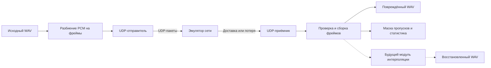
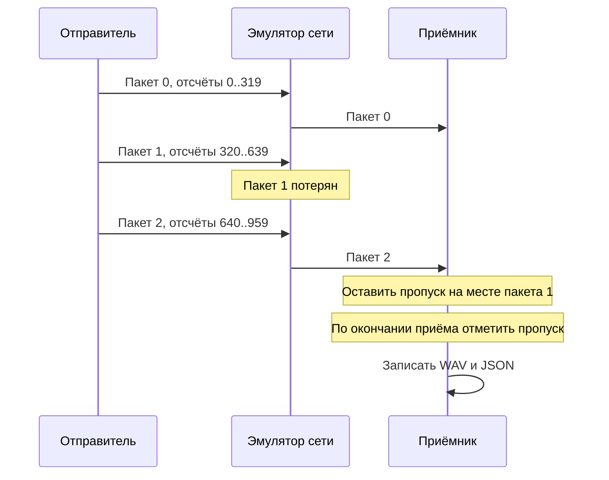

# EchoRestore

**Экспериментальная система передачи аудио по UDP и восстановления потерянных фрагментов сигнала.**

EchoRestore — проект на C++20 на стыке компьютерных сетей и вычислительной математики. Мы исследуем, как потери, задержки и изменение порядка доставки сетевых пакетов влияют на аудиосигнал и насколько хорошо методы интерполяции могут восстановить отсутствующие участки.

> **Текущий этап:** готовы каркас M0 и WAV-модуль M1. Сетевые приложения, сериализация пакетов, UDP и интерполяция ещё не реализованы.

## Сборка и запуск

Нужны Linux/WSL2, CMake 3.20+ и компилятор C++20 (GCC или Clang).
Сторонние зависимости не требуются.

```bash
cmake -S . -B build -DCMAKE_BUILD_TYPE=Debug
cmake --build build -j
./build/echorestore_generate_sample examples/sample.wav
```

Генератор создаёт
детерминированный WAV: 1 секунда, 16 кГц, моно, PCM16.

Тесты пока отложены: команда добавит их самостоятельно.
Структура модулей описана в [README.md](README.md). План следующих этапов — в
[docs/MILESTONES.md](docs/MILESTONES.md). [WAV-модуль](common/docs/WAV.md) уже читает
и записывает 16 кГц, моно, signed PCM16 с проверкой RIFF-чанков. Следующий шаг
M1 — сериализация пакетов после проверки WAV-модуля.

## Структура монорепозитория

- `common/` — реализованные WAV I/O и генератор образца; свои `src/`, `include/`,
  `apps/`, `docs/` и `CMakeLists.txt`.
- `network/docs/` — спецификация протокола и план сетевых экспериментов.
- `numerical/docs/` — описание будущей численной части.

Код, заголовки, приложения и CMake-цели сетевой и численной частей добавим
вместе с реализацией. Сейчас собираются только WAV-библиотека и генератор.
Границы компонентов описаны в [docs/ARCHITECTURE.md](docs/ARCHITECTURE.md).
Общий план этапов остаётся в корневом `docs/`, образцы — в `examples/`.

## Промышленная проблема

В голосовых звонках, видеоконференциях и других системах интерактивного аудио пакет может не прийти или прибыть слишком поздно для воспроизведения. Повторная передача не всегда успевает исправить ситуацию. Потерянные фрагменты способны вызывать щелчки, паузы и ухудшение разборчивости речи.

Для этого реальные системы используют **jitter buffer**, **packet loss concealment (PLC)**, а иногда и избыточное кодирование или повторные передачи. Например, RTP добавляет номера и временные метки медиапакетов, а WebRTC NetEq объединяет буферизацию с восстановлением потерь.

Наш проект **не претендует на новый промышленный аудиокодек**. Его цель — построить воспроизводимый экспериментальный стенд и сравнивать алгоритмы восстановления при контролируемых характеристиках сети.

## Общая схема



**Сетевая часть** отвечает за передачу реальных UDP-датаграмм, моделирование потерь, определение недостающих фреймов и восстановление их правильных позиций во временной шкале. **Вычислительная часть** будет получать отсчёты и маску пропущенных интервалов и вычислять значения, которыми можно заполнить пропуски. Эти модули проектируются независимо друг от друга.

## Первая версия: сетевая часть

- **Стек:** C++20, Linux/WSL2, POSIX sockets, CMake.
- **Аудио:** WAV, моно, 16 кГц, signed PCM16; один пакет содержит 20 мс звука (320 отсчётов, 640 байт), кроме последнего неполного пакета.
- **Протокол поверх UDP:** номер пакета, идентификатор сессии, позиция первого отсчёта и размер полезной нагрузки. Это учебный протокол, **не полноценный RTP**.
- **Эмулятор сети:** отдельный UDP-прокси, случайным образом отбрасывающий пакеты с заданной вероятностью и фиксируемым seed.
- **Приёмник:** собирает пакеты в правильном порядке, сохраняет отдельную маску отсутствующих отсчётов, обнаруживает дубликаты и записывает статистику.
- **Результат:** `damaged.wav`, в котором пропущенные интервалы заменены тишиной только для прослушивания, и `report.json` с координатами пропусков.



Для первой версии приёмнику заранее передаются **метаданные** аудиосессии (длина записи, формат, размер фрейма и идентификатор). Сам оригинальный звук ему не передаётся. Это позволяет обнаружить даже пропажу последнего пакета. Приём завершается после доставки всех ожидаемых пакетов либо по явному таймауту. Таймаут означает «не получен к моменту завершения эксперимента», а не доказательство окончательной потери в сети.

## Что будет добавлено

1. Моделирование задержек, jitter, групповых потерь, дубликатов и изменения порядка доставки.
2. Интерфейс вычислительного модуля и несколько алгоритмов интерполяции.
3. Сравнение исходного, повреждённого и восстановленного WAV, анализ качества при одинаковых сценариях потерь.
4. Real-time режим: jitter buffer, дедлайны воспроизведения, запас времени на интерполяцию и запасной быстрый алгоритм.
5. Более реалистичные сетевые эксперименты с `tc netem`/виртуальными узлами.

## Документация для разработки

Полная спецификация пакета, структура проекта, последовательность задач и критерии тестирования приведены в [AGENTS.md](AGENTS.md). Этот файл предназначен в том числе для Codex.

## Ссылки

- [RFC 3550 — RTP](https://www.rfc-editor.org/rfc/rfc3550)
- [WebRTC NetEq — jitter buffer и packet loss concealment](https://webrtc.googlesource.com/src/+/main/modules/audio_coding/neteq/g3doc/index.md)
